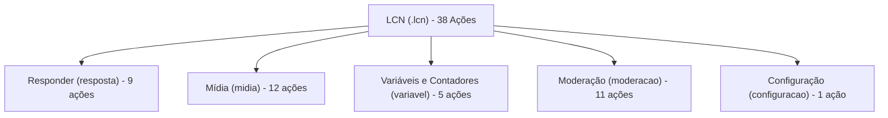

# Referência da Linguagem LCN (.lcn)

> **Fonte de Verdade**: Gerado a partir das definições canônicas em `src/lcn/vocabulario.js`, `src/engine/server/runtimeCapabilities.js`, `src/engine/server/schema/automation.v1.schema.json`, `src/web/public/logic/acoes.js` e `src/lcn/referencia.js`. Exemplos extraídos dos templates reais em `src/engine/templates/catalog/`.

---

## Índice

1. [Visão Geral e Contagens](#1-visão-geral-e-contagens)
2. [Divergências Entre Fontes](#2-divergências-entre-fontes)
3. [Cabeçalho da Automação](#3-cabeçalho-da-automação)
   - [Campos de Cabeçalho (23 campos)](#31-campos-de-cabeçalho)
   - [Marcas do Cabeçalho (5 marcas)](#32-marcas-do-cabeçalho)
4. [Ações Suportadas por Família (38 ações)](#4-ações-suportadas-por-família)
   - [Família: Responder (resposta - 9 ações)](#41-família-responder-resposta)
   - [Família: Mídia (midia - 12 ações)](#42-família-mídia-midia)
   - [Família: Variáveis e Contadores (variavel - 5 ações)](#43-família-variáveis-e-contadores-variavel)
   - [Família: Moderação (moderacao - 11 ações)](#44-família-moderação-moderacao)
   - [Família: Configuração pelo WhatsApp (configuracao - 1 ação)](#45-família-configuração-pelo-whatsapp-configuracao)
5. [Operadores de Comparação](#5-operadores-de-comparação)
6. [Escopos de Variável](#6-escopos-de-variável)
7. [Modos de Casamento do Comando](#7-modos-de-casamento-do-comando)
8. [Tipos Aceitos na Linguagem](#8-tipos-aceitos-na-linguagem)

---

## 1. Visão Geral e Contagens

| Categoria | Total de Itens | Fontes de Referência |
| :--- | :---: | :--- |
| **Ações Suportadas** | **38** | `ACOES_SUPORTADAS` (`runtimeCapabilities.js`), `ACOES` (`vocabulario.js`), `ACOES` (`acoes.js`) |
| **Campos de Cabeçalho (com valor)** | **23** | `CAMPOS_DO_CABECALHO` (`vocabulario.js`) |
| **Marcas de Cabeçalho (flags soltas)** | **5** | `MARCAS_DO_CABECALHO` (`vocabulario.js`) |
| **Total de Entradas de Cabeçalho** | **28** | 23 campos chave-valor + 5 marcas booleanas soltas |
| **Operadores de Comparação** | **10** | `OPERADORES_DE_COMPARACAO` (`runtimeCapabilities.js`), `OPERADORES` (`vocabulario.js`) |
| **Escopos de Variável (Runtime)** | **9** | `ESCOPOS_DE_VARIAVEL` (`runtimeCapabilities.js`), `ESCOPOS` (`acoes.js`) |
| **Escopos de Valor (Template/LCN)** | **8** | `ESCOPOS_DE_VALOR` (`vocabulario.js`) |
| **Modos de Casamento** | **4** | `CASAMENTOS` (`vocabulario.js`) |
| **Tipos de Configuração de Template** | **4** | `TIPOS_DE_CONFIG` (`vocabulario.js`) |
| **Tipos de Valor de Variável** | **3** | `TIPOS_DE_VALOR` (`vocabulario.js`) |
| **Tipos de Mensagem Observáveis** | **7** | `TIPOS_DE_MENSAGEM` (`vocabulario.js`) |
| **Ações de Grupo do Porteiro** | **5** | `ACOES_DE_GRUPO` (`vocabulario.js`) |
| **Classes de Automação** | **3** | `CLASSES` (`vocabulario.js`) |
| **Prioridades de Agendamento** | **4** | `PRIORIDADES_SUPORTADAS` (`runtimeCapabilities.js`), `PRIORIDADES` (`vocabulario.js`) |
| **Templates Reais no Catálogo** | **42** | Diretório `src/engine/templates/catalog/` |

---

## 2. Divergências Entre Fontes

Durante a análise exaustiva cruzada das fontes canônicas (`runtimeCapabilities.js`, `vocabulario.js`, `automation.v1.schema.json`, `referencia.js`, `acoes.js` e templates em `src/engine/templates/catalog/`), foram identificadas as seguintes divergências:

1. **Ação `action.http` no Schema JSON vs. Runtime e Vocabulário**:
   - `automation.v1.schema.json` lista 39 definições de ação, incluindo `action.http`.
   - `runtimeCapabilities.js` (`ACOES_SUPORTADAS`), `vocabulario.js` (`ACOES`) e `acoes.js` (`ACOES`) listam exatamente **38 ações**.
   - *Motivo documentado*: A ação `action.http` foi deliberadamente desabilitada e é rejeitada na validação de publicação pelo Invariante 7 do sistema de segurança, não possuindo palavra-chave na linguagem `.lcn` nem executor de runtime.

2. **Comentário Histórico em `src/lcn/referencia.js` vs. Vocabulário Real**:
   - O comentário no início de `src/lcn/referencia.js` (linha 3) cita: *"a linguagem tem 13 ações, 20 campos de cabeçalho..."*.
   - Este número é um registro histórico de uma versão inicial da linguagem. O vocabulário real possui **38 ações**, **23 campos de cabeçalho** e **5 marcas de cabeçalho**.

3. **Escopos de Variável Canônicos (9) vs. Escopos de Template LCN (8)**:
   - `runtimeCapabilities.js` (`ESCOPOS_DE_VARIAVEL`) e `acoes.js` (`ESCOPOS`) definem **9 escopos canônicos**: `chat`, `sender`, `group`, `group_member`, `target`, `target_group_member`, `category`, `global`, `local`.
   - `vocabulario.js` (`ESCOPOS_DE_VALOR`) define **8 identificadores para o bloco `declara`**: `chat`, `sender`, `member`, `target`, `targetMember`, `category`, `global`, `local`.
   - *Divergência*: O vocabulário de template utiliza os mnemônicos amigáveis `member` (em vez de `group_member`) e `targetMember` (em vez de `target_group_member`), e não inclui `group` isolado (pois no template de declaração ele é unificado sob `chat`).

4. **Operador Diferente de (`ne` vs `neq`)**:
   - Em revisões anteriores, o vocabulário utilizava a chave `ne`, enquanto o schema e o runtime esperavam `neq`. Atualmente, `vocabulario.js` e `runtimeCapabilities.js` convergem ambos para `neq` (`!=`), prevenindo rejeição no publish.

5. **Ações Suportadas vs. Presença no Catálogo de Templates**:
   - Das 38 ações executáveis pela linguagem, **30 ações** possuem exemplos em templates reais no catálogo `src/engine/templates/catalog/` (que totaliza 42 templates).
   - **8 ações** são suportadas no compilador, vocabulário e runtime, mas não são utilizadas diretamente em nenhum template padrão empacotado no catálogo: `action.whatsapp.rich` (`responde rico`), `action.whatsapp.sendFile` (`envia arquivo`), `action.acervo.save` (`guarda no acervo`), `action.acervo.read` (`lê do acervo`), `action.group.add` (`adiciona no grupo`), `action.group.setSubject` (`muda o nome do grupo`), `action.group.setDescription` (`muda a descrição do grupo`) e `action.group.setAnnounce` (`fecha o grupo`).

---

## 3. Cabeçalho da Automação

O cabeçalho define a identidade, gatilho, políticas de entrada, prioridade e escopo de execução da automação.

### 3.1. Campos de Cabeçalho (23 campos)

Campos estruturados no formato `chave: valor`.

#### 1. `tipo`
- **Nome técnico**: `type` / `class`
- **O que faz**: Define a classe fundamental da automação: `comando` (acionado por texto de usuário), `vigia` (monitora mensagens passivas) ou `porteiro` (monitora eventos estruturais de grupo).
- **Parâmetros e Tipos**: Palavra fechada (`comando`, `vigia`, `porteiro`). Obrigatório para toda automação.
- **Exemplo real (.lcn)**:
  ```lcn
  tipo: comando
  ```
  *(Citado de: `src/engine/templates/catalog/ping.lcn`)*

#### 2. `dispara com`
- **Nome técnico**: `command` (comando) / gatilho passivo (vigia)
- **O que faz**: Especifica a palavra de comando digitada (com suporte a atalhos separados por vírgula) ou a frase `"qualquer mensagem"` para regras de vigia.
- **Parâmetros e Tipos**: Texto livre ou lista separada por vírgulas. Obrigatório em comandos.
- **Exemplo real (.lcn)**:
  ```lcn
  dispara com: {{params.command}}
  ```
  *(Citado de: `src/engine/templates/catalog/ping.lcn`)*

#### 3. `casa`
- **Nome técnico**: `match`
- **O que faz**: Configura a estratégia de comparação textual entre o que o usuário digitou e a palavra do comando.
- **Parâmetros e Tipos**: Palavra fechada (`exato`, `exato ou com argumentos`, `começa com`, `palavra solta`). Padrão: `exato`.
- **Exemplo real (.lcn)**:
  ```lcn
  casa: exato ou com argumentos
  ```
  *(Citado de: `src/engine/templates/catalog/calcular-total.lcn`)*

#### 4. `quem`
- **Nome técnico**: `allowFrom`
- **O que faz**: Restringe a permissão de acionamento: `só externos` (o bot ignora mensagens de seu próprio número) ou `qualquer um` (responde a comandos enviados pela própria conta).
- **Parâmetros e Tipos**: Palavra fechada (`só externos`, `qualquer um`).
- **Exemplo real (.lcn)**:
  ```lcn
  quem: só externos
  ```
  *(Citado de: `src/engine/templates/catalog/anti-link.lcn`)*

#### 5. `argumentos`
- **Nome técnico**: `args`
- **O que faz**: Divide o texto digitado após o comando em parâmetros nomeados separados por um delimitador configurado.
- **Parâmetros e Tipos**: Texto no formato `param1 / param2`.
- **Exemplo real (.lcn)**:
  ```lcn
  argumentos: preco / quantidade
  ```
  *(Citado de: `src/engine/templates/catalog/calcular-total.lcn`)*

#### 6. `palavras`
- **Nome técnico**: `keywords`
- **O que faz**: Define uma lista de palavras-chave que despertam a automação vigia se qualquer uma estiver presente no texto recebido.
- **Parâmetros e Tipos**: Lista de palavras separadas por vírgula. Válido apenas para vigia.
- **Exemplo real (.lcn)**:
  ```lcn
  palavras: bom dia, boa tarde, boa noite
  ```
  *(Citado da gramática canônica: `src/lcn/referencia.js`)*

#### 7. `quando for`
- **Nome técnico**: `messageKinds` (vigia) / `actions` (porteiro)
- **O que faz**: No vigia, filtra os tipos de mensagem recebidos (texto, foto...); no porteiro, filtra os eventos de grupo observados (entrou, saiu, promoveu, rebaixou, mudou o nome).
- **Parâmetros e Tipos**: Valores de `TIPOS_DE_MENSAGEM` ou `ACOES_DE_GRUPO`.
- **Exemplo real (.lcn)**:
  ```lcn
  quando for: entrou
  ```
  *(Citado de: `src/engine/templates/catalog/porteiro.lcn`)*

#### 8. `acessa`
- **Nome técnico**: `inputPolicy.acceptedMessageKinds`
- **O que faz**: Declara explicitamente quais tipos físicos de mensagem a automação tem permissão de receber e processar da conexão do WhatsApp.
- **Parâmetros e Tipos**: Lista de tipos (`texto`, `áudio`, `foto`, `vídeo`, `documento`, `visualização única`, `figurinha`).
- **Exemplo real (.lcn)**:
  ```lcn
  acessa: texto, foto, vídeo, áudio, documento
  ```
  *(Citado de: `src/engine/templates/catalog/anti-silenciado.lcn`)*

#### 9. `precisa de um link`
- **Nome técnico**: `requiredLink`
- **O que faz**: Exige a presença de um link para o fluxo rodar e determina a ordem de busca (na mensagem atual ou na mensagem respondida).
- **Parâmetros e Tipos**: Palavra fechada (`na mensagem`, `na citada`, `na mensagem ou na citada`, `na citada ou na mensagem`).
- **Exemplo real (.lcn)**:
  ```lcn
  precisa de um link: na citada ou na mensagem
  ```
  *(Citado de: `src/engine/templates/catalog/baixar-midia.lcn`)*

#### 10. `precisa de uma mídia`
- **Nome técnico**: `requiredMedia`
- **O que faz**: Exige a presença de um arquivo de mídia (foto, vídeo, áudio, documento) e define onde o motor deve localizá-lo.
- **Parâmetros e Tipos**: Palavra fechada (`na mensagem`, `na citada`, `na mensagem ou na citada`, `na citada ou na mensagem`).
- **Exemplo real (.lcn)**:
  ```lcn
  precisa de uma mídia: na mensagem ou na citada
  ```
  *(Citado de: `src/engine/templates/catalog/melhorar-foto.lcn`)*

#### 11. `sem ele`
- **Nome técnico**: `missingLinkText`
- **O que faz**: Mensagem de resposta automática caso o link exigido por `precisa de um link` não seja encontrado.
- **Parâmetros e Tipos**: Texto entre aspas. Depende de `precisa de um link`.
- **Exemplo real (.lcn)**:
  ```lcn
  sem ele: "{{params.semLinkText}}"
  ```
  *(Citado de: `src/engine/templates/catalog/baixar-midia.lcn`)*

#### 12. `sem ela`
- **Nome técnico**: `missingMediaText`
- **O que faz**: Mensagem de resposta automática caso a mídia exigida por `precisa de uma mídia` não seja fornecida.
- **Parâmetros e Tipos**: Texto entre aspas. Depende de `precisa de uma mídia`.
- **Exemplo real (.lcn)**:
  ```lcn
  sem ela: "{{params.semMidiaText}}"
  ```
  *(Citado de: `src/engine/templates/catalog/melhorar-foto.lcn`)*

#### 13. `id`
- **Nome técnico**: `id`
- **O que faz**: Identificador exclusivo e imutável da automação no banco de dados.
- **Parâmetros e Tipos**: Texto identificador sem espaços.
- **Exemplo real (.lcn)**:
  ```lcn
  id: meu-comando
  ```
  *(Citado de: `src/lcn/referencia.js`)*

#### 14. `revisão`
- **Nome técnico**: `revision`
- **O que faz**: Número sequencial de revisão do documento de automação compilado.
- **Parâmetros e Tipos**: Número inteiro positivo.
- **Exemplo real (.lcn)**:
  ```lcn
  revisão: 1
  ```
  *(Citado da gramática canônica: `src/lcn/vocabulario.js`)*

#### 15. `nome`
- **Nome técnico**: `name`
- **O que faz**: Título descritivo amigável exibido no painel de controle e listagens de automações.
- **Parâmetros e Tipos**: Texto livre.
- **Exemplo real (.lcn)**:
  ```lcn
  nome: Ping
  ```
  *(Citado de: `src/engine/templates/catalog/ping.lcn`)*

#### 16. `menu`
- **Nome técnico**: `display.menuLabel` e `display.menuDescription`
- **O que faz**: Define como o comando aparece no `/menu` gerado automaticamente, no padrão `"rótulo — descrição"`.
- **Parâmetros e Tipos**: Texto no formato `"rótulo — descrição"`.
- **Exemplo real (.lcn)**:
  ```lcn
  menu: {{params.command}} — Responde pong com o tempo de resposta
  ```
  *(Citado de: `src/engine/templates/catalog/ping.lcn`)*

#### 17. `família`
- **Nome técnico**: `display.family`
- **O que faz**: Agrupa comandos sob uma mesma etiqueta administrativa para ligar e desligar um conjunto inteiro de uma vez em conversas específicas.
- **Parâmetros e Tipos**: Texto livre (ex: `utils`, `download`, `moderacao`).
- **Exemplo real (.lcn)**:
  ```lcn
  família: {{params.familia}}
  ```
  *(Citado de: `src/engine/templates/catalog/ping.lcn`)*

#### 18. `onde`
- **Nome técnico**: `scope.include`
- **O que faz**: Define os destinos e conversas onde a automação está autorizada a rodar. Pode ser repetido para múltiplos destinos.
- **Parâmetros e Tipos**: Enum `DESTINOS` (`em qualquer lugar`, `todos os contatos`, `todos os grupos`, `contato <id>`, `grupo <id>`, `marcadas com <tag>`).
- **Exemplo real (.lcn)**:
  ```lcn
  onde: todos os grupos
  ```
  *(Citado de: `src/engine/templates/catalog/rebaixar.lcn`)*

#### 19. `menos`
- **Nome técnico**: `scope.exclude`
- **O que faz**: Define exceções aos destinos do campo `onde` (ex: rodar em todos os grupos menos em um grupo específico).
- **Parâmetros e Tipos**: Enum `DESTINOS`. Repetível.
- **Exemplo real (.lcn)**:
  ```lcn
  menos: grupo 120363000000000001@g.us
  ```
  *(Citado da gramática canônica: `src/lcn/vocabulario.js`)*

#### 20. `pool`
- **Nome técnico**: `responder.poolId`
- **O que faz**: Identifica o conjunto de números (pool) do gateway responsável por emitir as respostas desta automação.
- **Parâmetros e Tipos**: Texto com o identificador do pool.
- **Exemplo real (.lcn)**:
  ```lcn
  pool: {{params.poolId}}
  ```
  *(Citado de: `src/engine/templates/catalog/ping.lcn`)*

#### 21. `histórico`
- **Nome técnico**: `inputPolicy.historyPolicy`
- **O que faz**: Especifica se a automação deve processar apenas mensagens recebidas ao vivo (`só novas`) ou reprocessar mensagens antigas (`com histórico`).
- **Parâmetros e Tipos**: Palavra fechada (`só novas` -> `live_only`, `com histórico` -> `replay_and_live`).
- **Exemplo real (.lcn)**:
  ```lcn
  histórico: só novas
  ```
  *(Citado da gramática canônica: `src/lcn/vocabulario.js`)*

#### 22. `prioridade`
- **Nome técnico**: `scheduling.priority`
- **O que faz**: Define o nível de urgência na fila de entrega com base na perecibilidade do evento (ex: mídia de visualização única é efêmera e recebe urgência máxima).
- **Parâmetros e Tipos**: Enum `PRIORIDADES` (`baixa`, `normal`, `alta`, `muito alta`). Padrão: `normal`.
- **Exemplo real (.lcn)**:
  ```lcn
  prioridade: muito alta
  ```
  *(Citado do teste oficial: `tests/prioridade-na-linguagem.test.mjs`)*

#### 23. `sem vaga`
- **Nome técnico**: `scheduling.onNoSlot`
- **O que faz**: Define a conduta do sistema quando a fila estiver cheia: descartar silenciosamente ou enviar mensagem explicativa ao remetente.
- **Parâmetros e Tipos**: `descarta` (modo silencioso) ou texto entre aspas com o aviso de recusa.
- **Exemplo real (.lcn)**:
  ```lcn
  sem vaga: "Tá cheio agora."
  ```
  *(Citado do teste oficial: `tests/prioridade-na-linguagem.test.mjs`)*

---

### 3.2. Marcas do Cabeçalho (5 marcas)

Linhas independentes sem dois-pontos ou valor. A simples presença da marca ativa a respectiva flag booleana.

#### 1. `só dono`
- **Nome técnico**: `requireOwner` (`true`)
- **O que faz**: Trava a execução da automação exclusivamente para números cadastrados como proprietários do bot.
- **Exemplo real (.lcn)**:
  ```lcn
  só dono
  ```
  *(Citado de: `src/engine/templates/catalog/config-menu.lcn`)*

#### 2. `com link`
- **Nome técnico**: `containsLink` (`true`)
- **O que faz**: Faz a automação vigia responder apenas quando a mensagem contiver um link web detectado.
- **Exemplo real (.lcn)**:
  ```lcn
  com link
  ```
  *(Citado de: `src/engine/templates/catalog/auto-download.lcn`)*

#### 3. `só link de mídia`
- **Nome técnico**: `mediaLinkOnly` (`true`)
- **O que faz**: Refina o detector de links para ignorar links genéricos (notícias, lojas) e reagir apenas a links de posts de redes sociais com mídia suportada.
- **Exemplo real (.lcn)**:
  ```lcn
  só link de mídia
  ```
  *(Citado de: `src/engine/templates/catalog/auto-download.lcn`)*

#### 4. `também em comandos`
- **Nome técnico**: `alsoOnCommands` (`true`)
- **O que faz**: Faz uma regra vigia rodar mesmo em mensagens que foram reconhecidas e processadas como comandos (útil para auditoria ou moderação de silenciados).
- **Exemplo real (.lcn)**:
  ```lcn
  também em comandos
  ```
  *(Citado de: `src/engine/templates/catalog/anti-silenciado.lcn`)*

#### 5. `desligada`
- **Nome técnico**: `enabled: false`
- **O que faz**: Registra a automação como desativada de fábrica, não respondendo a mensagens até ser ativada manualmente pelo operador no painel.
- **Exemplo real (.lcn)**:
  ```lcn
  desligada
  ```
  *(Citado da gramática canônica: `src/lcn/vocabulario.js`)*

---

## 4. Ações Suportadas por Família

As 38 ações executáveis da linguagem `.lcn` são agrupadas nas 5 famílias oficiais do sistema:



---

### 4.1. Família: Responder (`resposta`)

Compreende 9 ações dedicadas à interação direta de mensagens, menus e enquetes.

#### 1. `responde`
- **Nome técnico**: `action.whatsapp.reply`
- **O que faz**: Envia uma mensagem de texto na mesma conversa, com suporte a variáveis interpoladas, numeração automática e menções reais de contato.
- **Parâmetros**:
  - `text` (*string*, obrigatório, inline): Texto da resposta.
  - `numbered` (*boolean*, opcional, rótulo: `numeração`): Numera as linhas não vazias a partir de 1.
  - `mentions` (*string*, opcional, rótulo: `marca`): Identificadores de telefone a mencionar com `@` real.
  - `forward` (*boolean*, opcional, rótulo: `encaminhada`): Adiciona o selo de mensagem encaminhada.
- **Exemplo real (.lcn)**:
  ```lcn
  responde "pong ({{latencyMs}}ms)"
  ```
  *(Citado de: `src/engine/templates/catalog/ping.lcn`)*

#### 2. `responde rico`
- **Nome técnico**: `action.whatsapp.rich`
- **O que faz**: Envia mensagem com formatação de código colorido ou fórmula matemática (LaTeX) com queda automática para texto se recusado pelo cliente.
- **Parâmetros**:
  - `text` (*string*, obrigatório, inline): Bloco de código ou fórmula matemática.
  - `richKind` (*enum: `code`, `latex`, `text`*, obrigatório, rótulo: `formato`, valores: `código`, `fórmula`, `texto`): Formato rico desejado.
  - `language` (*string*, opcional, rótulo: `linguagem`): Linguagem de programação para coloração sintática.
  - `fallbackText` (*string*, opcional, rótulo: `senão`): Texto simples enviado caso a renderização rica falhe.
- **Exemplo real (.lcn)**:
  ```lcn
  responde rico "console.log('oi')"
  ```
  *(Ação suportada no runtime; exemplo canônico estruturado de acordo com `vocabulario.js` e `tests/lcn-ida-e-volta.test.mjs`)*

#### 3. `responde com botões`
- **Nome técnico**: `action.whatsapp.buttons`
- **O que faz**: Envia mensagem com até 3 botões interativos de resposta rápida que disparam comandos quando tocados.
- **Parâmetros**:
  - `text` (*string*, obrigatório, inline): Mensagem principal exibida acima dos botões.
  - `buttons` (*array [1..3]*, obrigatório, sintaxe: `botão "Rótulo": "/comando"`): Lista dos botões interativos.
  - `footer` (*string*, opcional, rótulo: `rodapé`): Texto secundário abaixo dos botões.
  - `fallbackText` (*string*, opcional, rótulo: `senão`): Texto simples com as opções caso o aparelho não renderize botões.
- **Exemplo real (.lcn)**:
  ```lcn
  responde com botões "{{params.texto}}"
  ```
  *(Citado de: `src/engine/templates/catalog/botoes-escolha.lcn`)*

#### 4. `abre página`
- **Nome técnico**: `action.whatsapp.webview`
- **O que faz**: Envia mensagem com botão que abre um endereço web externo ou uma janela em tela cheia no próprio WhatsApp.
- **Parâmetros**:
  - `text` (*string*, obrigatório, inline): Texto descritivo acima do botão.
  - `url` (*string uri*, obrigatório, rótulo: `endereço`): Endereço web (`http` ou `https`).
  - `buttonLabel` (*string*, obrigatório, rótulo: `botão`): Rótulo textual do botão.
  - `footer` (*string*, opcional, rótulo: `rodapé`): Texto de rodapé.
  - `inApp` (*boolean*, opcional, rótulo: `dentro do WhatsApp`): Se abre em janela sobreposta no WhatsApp ou no navegador padrão.
  - `forma` (*enum: `link`, `janela`, `diagnóstico`*, opcional, rótulo: `forma`): Modo técnico de montagem do botão.
- **Exemplo real (.lcn)**:
  ```lcn
  abre página
  ```
  *(Citado de: `src/engine/templates/catalog/abrir-pagina.lcn`)*

#### 5. `reage`
- **Nome técnico**: `action.whatsapp.react`
- **O que faz**: Insere uma reação de emoji na mensagem respondida ou revoga a reação se deixado vazio.
- **Parâmetros**:
  - `emoji` (*string*, opcional, inline): Emoji da reação (string vazia desfaz).
  - `notFoundText` (*string*, opcional, rótulo: `sem alvo`): Mensagem de resposta quando nada foi respondido.
- **Exemplo real (.lcn)**:
  ```lcn
  reage "{{params.emoji}}"
  ```
  *(Citado de: `src/engine/templates/catalog/reagir.lcn`)*

#### 6. `mostra metadados`
- **Nome técnico**: `action.whatsapp.metadata`
- **O que faz**: Responde na conversa os dados estruturados da mensagem recebida (remetente, IDs, botões tocados e cards).
- **Parâmetros**:
  - *Sem parâmetros de configuração* (configuração vazia `{}`).
- **Exemplo real (.lcn)**:
  ```lcn
  mostra metadados
  ```
  *(Citado de: `src/engine/templates/catalog/metadados.lcn`)*

#### 7. `abre uma enquete`
- **Nome técnico**: `action.whatsapp.poll`
- **O que faz**: Cria e envia uma enquete nativa do WhatsApp com opções de votação calculadas pela plataforma.
- **Parâmetros**:
  - `question` (*string*, obrigatório, rótulo: `pergunta`): Pergunta da enquete.
  - `options` (*string ou array*, obrigatório, rótulo: `opções`): Alternativas de voto separadas por ponto e vírgula.
  - `selectableCount` (*integer [1..32]*, opcional, rótulo: `quantas dá para marcar`): Número máximo de opções que cada usuário pode selecionar.
- **Exemplo real (.lcn)**:
  ```lcn
  abre uma enquete
  ```
  *(Citado de: `src/engine/templates/catalog/enquete.lcn`)*

#### 8. `mostra o resultado da enquete`
- **Nome técnico**: `action.whatsapp.pollResults`
- **O que faz**: Apresenta por escrito a contagem de votos registrados para cada opção da última enquete identificada.
- **Parâmetros**:
  - `headerText` (*string*, opcional, rótulo: `título`): Título antes das posições.
  - `lineFormat` (*string*, opcional, rótulo: `cada linha`): Formatação de cada linha com `{{opcao}}` e `{{votos}}`.
  - `emptyText` (*string*, opcional, rótulo: `sem votos`): Mensagem quando não houver votos ou contagem registrada.
- **Exemplo real (.lcn)**:
  ```lcn
  mostra o resultado da enquete
  ```
  *(Citado de: `src/engine/templates/catalog/resultado-da-enquete.lcn`)*

#### 9. `mostra menu`
- **Nome técnico**: `action.menu.render`
- **O que faz**: Gera e envia o menu de comandos permitidos naquela conversa em formato texto ou lista interativa.
- **Parâmetros**:
  - `numbered` (*boolean*, opcional, rótulo: `numeração`): Numera os comandos visíveis.
  - `format` (*enum: `text`, `interactive`*, opcional, rótulo: `formato`, valores: `texto`, `com botões`): Estilo de apresentação.
  - `header` (*string*, opcional, rótulo: `cabeçalho`): Texto de introdução.
  - `footer` (*string*, opcional, rótulo: `rodapé`): Texto de rodapé.
  - `emptyText` (*string*, opcional, rótulo: `vazio`): Mensagem exibida se não houver comandos habilitados.
  - `buttonTitle` (*string*, opcional, rótulo: `botão`): Título do botão no formato interativo.
- **Exemplo real (.lcn)**:
  ```lcn
  mostra menu
  ```
  *(Citado de: `src/engine/templates/catalog/menu.lcn`)*

---

### 4.2. Família: Mídia (`midia`)

Compreende 12 ações voltadas para gerenciamento de arquivos no acervo, captura de fotos efêmeras, carrosséis, pacotes de figurinhas e conexões externas.

#### 10. `envia arquivo`
- **Nome técnico**: `action.whatsapp.sendFile`
- **O que faz**: Envia um arquivo guardado no acervo (imagem, áudio, vídeo, PDF ou texto) pelo caminho ou identificador.
- **Parâmetros**:
  - `path` (*string*, opcional, inline): Caminho relativo do arquivo no acervo.
  - `fileId` (*string*, opcional, rótulo: `id`): Identificador estável do arquivo.
  - `folder` (*string*, opcional, rótulo: `pasta`): Pasta para envio de todos os arquivos contidos.
  - `delivery` (*enum: `carousel`, `album`, `separate`*, opcional, rótulo: `entrega`, valores: `carrossel`, `álbum`, `separado`): Modo de entrega para pastas com múltiplas mídias.
  - `caption` (*string*, opcional, rótulo: `legenda`): Legenda enviada com a mídia.
  - `viewOnce` (*boolean*, opcional, rótulo: `visualização única`): Pede entrega como mídia efêmera de visualização única.
  - `notFoundText` (*string*, opcional, rótulo: `sem arquivo`): Resposta enviada se o arquivo não existir no acervo.
- **Exemplo real (.lcn)**:
  ```lcn
  envia arquivo "produtos/cardapio.pdf"
  ```
  *(Ação suportada no runtime; exemplo canônico conforme `src/lcn/vocabulario.js` e `tests/envio-visu-unica.test.mjs`)*

#### 11. `guarda no acervo`
- **Nome técnico**: `action.acervo.save`
- **O que faz**: Salva a mídia enviada ou citada na conversa no acervo do bot para reutilização futura.
- **Parâmetros**:
  - `folder` (*string*, opcional, rótulo: `pasta`): Pasta lógica de organização no acervo.
  - `name` (*string*, opcional, rótulo: `nome`): Nome dado ao arquivo.
  - `description` (*string*, opcional, rótulo: `descrição`): Descrição para identificação no acervo.
  - `okText` (*string*, opcional, rótulo: `confirma`): Mensagem de confirmação após salvar (`{{caminho}}`, `{{id}}`, `{{nome}}`).
  - `notFoundText` (*string*, opcional, rótulo: `sem arquivo`): Mensagem enviada se nenhuma mídia for encontrada na mensagem ou citação.
  - `errorText` (*string*, opcional, rótulo: `erro`): Mensagem enviada caso a gravação falhe (`{{erro}}`).
- **Exemplo real (.lcn)**:
  ```lcn
  guarda no acervo
  ```
  *(Ação suportada no runtime; exemplo canônico conforme `src/lcn/vocabulario.js`)*

#### 12. `lê do acervo`
- **Nome técnico**: `action.acervo.read`
- **O que faz**: Lê metadados de um arquivo do acervo (nome, pasta, tipo, tamanho, descrição) disponibilizando-os para as próximas ações do fluxo. Com `com o conteúdo`, entrega também o texto de arquivos `text/plain` e JSON, só se couberem inteiros no limite de leitura (64 KiB por padrão); se não couberem, o fluxo segue sem o texto.
- **Parâmetros**:
  - `path` (*string*, obrigatório, rótulo: `arquivo`): Caminho do arquivo a consultar.
  - `content` (*boolean*, opcional, rótulo: `com o conteúdo`): Também ler o texto do arquivo.
  - `notFoundText` (*string*, opcional, rótulo: `sem arquivo`): Resposta enviada se o item não existir no acervo.
- **Exemplo real (.lcn)**:
  ```lcn
  lê do acervo
  ```
  *(Ação suportada no runtime; exemplo canônico conforme `tests/membros-e-acervo-lido.test.mjs`)*

#### 12b. `edita no acervo`
- **Nome técnico**: `action.acervo.edit`
- **O que faz**: Muda UM item de um arquivo sem reescrever o resto. Em JSON que é lista de textos (ou números), acrescenta ou tira um item; em texto, acrescenta uma linha no fim. A leitura, a mudança e a gravação acontecem juntas no gateway, então vários pedidos ao mesmo tempo somam em vez de um apagar o outro.
- **Parâmetros**:
  - `path` (*string*, obrigatório, inline): Caminho do arquivo (ou id de 24 caracteres).
  - `mode` (*enum: `jsonAdd`, `jsonRemove`, `appendLine`*, obrigatório, rótulo: `modo`, valores: `adicionando item`, `tirando item`, `acrescentando linha`): O que fazer. Os modos de JSON exigem arquivo `application/json`; `appendLine` exige `text/plain`.
  - `value` (*string*, obrigatório, rótulo: `valor`): O item ou a linha. Até 4096 bytes; para linha, sem quebra de linha.
  - `asNumber` (*boolean*, opcional, rótulo: `como número`): Trata o valor como número (`3` e `"3"` são itens diferentes).
  - `okText` (*string*, opcional, rótulo: `confirma`): Resposta quando mudou. Aceita `{{total}}`, `{{caminho}}`, `{{nome}}`, `{{id}}`.
  - `unchangedText` (*string*, opcional, rótulo: `sem mudança`): Resposta quando o item já estava (ou não estava) lá.
  - `notFoundText` (*string*, opcional, rótulo: `sem arquivo`): Resposta se o arquivo não existir.
  - `errorText` (*string*, opcional, rótulo: `erro`): Resposta em caso de falha.
- **Exemplo real (.lcn)**:
  ```lcn
  edita no acervo "{{params.caminho}}"
  ```
  *(Citado de: `src/engine/templates/catalog/acervo-adicionar-item.lcn`)*

#### 13. `apaga do acervo`
- **Nome técnico**: `action.acervo.delete`
- **O que faz**: Remove permanentemente um arquivo do acervo pelo caminho ou ID, liberando espaço de armazenamento.
- **Parâmetros**:
  - `path` (*string*, opcional, inline): Caminho do arquivo a ser excluído.
  - `fileId` (*string*, opcional, rótulo: `id`): Identificador estável do arquivo.
  - `okText` (*string*, opcional, rótulo: `confirma`): Mensagem de confirmação após a remoção.
  - `notFoundText` (*string*, opcional, rótulo: `sem arquivo`): Mensagem se o arquivo não existir.
  - `errorText` (*string*, opcional, rótulo: `erro`): Mensagem de erro em caso de falha física.
- **Exemplo real (.lcn)**:
  ```lcn
  apaga do acervo "{{params.caminho}}"
  ```
  *(Citado de: `src/engine/templates/catalog/apagar-arquivo.lcn`)*

#### 14. `cria texto no acervo`
- **Nome técnico**: `action.acervo.createText`
- **O que faz**: Cria um arquivo de texto no acervo a partir de strings e variáveis conhecidas (como recibos ou notas).
- **Parâmetros**:
  - `path` (*string*, obrigatório, inline): Caminho completo onde salvar o arquivo texto.
  - `text` (*string*, obrigatório, rótulo: `conteúdo`): Conteúdo textual a ser gravado.
  - `name` (*string*, opcional, rótulo: `nome`): Nome amigável do arquivo.
  - `folder` (*string*, opcional, rótulo: `pasta`): Pasta de destino.
  - `description` (*string*, opcional, rótulo: `descrição`): Descrição do item.
  - `okText` (*string*, opcional, rótulo: `confirma`): Resposta enviada após criar com sucesso.
  - `errorText` (*string*, opcional, rótulo: `erro`): Mensagem de erro em caso de falha de cota ou gravação.
- **Exemplo real (.lcn)**:
  ```lcn
  cria texto no acervo "{{params.caminho}}"
  ```
  *(Citado de: `src/engine/templates/catalog/criar-nota.lcn`)*

#### 15. `sobrescreve no acervo`
- **Nome técnico**: `action.acervo.rewrite`
- **O que faz**: Substitui o conteúdo textual ou mídia de um arquivo existente mantendo intacto seu ID estável no acervo.
- **Parâmetros**:
  - `path` (*string*, opcional, inline): Caminho do arquivo a ser reescrito.
  - `fileId` (*string*, opcional, rótulo: `id`): ID do arquivo a sobrescrever.
  - `text` (*string*, opcional, rótulo: `conteúdo`): Novo texto (se omitido, usa a mídia recebida na mensagem).
  - `okText` (*string*, opcional, rótulo: `confirma`): Resposta após atualização bem-sucedida.
  - `notFoundText` (*string*, opcional, rótulo: `sem arquivo`): Resposta se o arquivo não for encontrado ou faltar mídia.
  - `errorText` (*string*, opcional, rótulo: `erro`): Resposta em caso de erro.
- **Exemplo real (.lcn)**:
  ```lcn
  sobrescreve no acervo "{{params.caminho}}"
  ```
  *(Citado de: `src/engine/templates/catalog/atualizar-nota.lcn`)*

#### 16. `chama`
- **Nome técnico**: `action.connection.call`
- **O que faz**: Dispara uma chamada para uma função declarada em uma Conexão externa (HTTP/API) enviando dados e arquivos com entrega configurável.
- **Parâmetros**:
  - `alvo` (*conexão.função*, obrigatório, inline): Conexão e função no formato `conexao.funcao`.
  - `inputs` (*object*, opcional, bloco `com`): Entradas mapeadas para o payload da função externa.
  - `mediaInput` (*string*, opcional): Entrada que recebe a mídia primária (`a mídia`, `a mídia citada`, `a mídia anexada`, `o resultado`).
  - `mediaInput2` (*string*, opcional): Entrada que recebe a segunda mídia para funções de duas fotos.
  - `delivery` (*enum: `carousel`, `album`, `separate`*, opcional, rótulo: `entrega`, valores: `carrossel`, `álbum`, `separado`): Como entregar múltiplas mídias retornadas.
  - `ackText` (*string*, opcional, rótulo: `avisa`): Mensagem de aviso prévio ao iniciar a consulta externa.
  - `caption` (*string*, opcional, rótulo: `legenda`): Legenda da resposta caso retorne mídia.
  - `quoteFrom` (*enum: `citada`, `mensagem`*, opcional, rótulo: `cita`, valores: `a citada`, `quem pediu`): Qual mensagem deve ser respondida/citada.
  - `notFoundText` (*string*, opcional, rótulo: `sem dados`): Mensagem enviada se faltar mídia ou dados requeridos.
  - `errorText` (*string*, opcional, rótulo: `erro`): Mensagem de falha caso a conexão retorne erro (`{{erro}}`).
- **Exemplo real (.lcn)**:
  ```lcn
  chama {{params.conexao}}.musica
  ```
  *(Citado de: `src/engine/templates/catalog/tocar-musica.lcn`)*

#### 17. `baixa`
- **Nome técnico**: `action.media.download`
- **O que faz**: Envia um link para o serviço de download externo configurado e entrega o vídeo, áudio ou imagem no WhatsApp.
- **Parâmetros**:
  - `url` (*string*, obrigatório, inline): Link a ser baixado.
  - `modo` (*enum: `auto`, `video`, `audio`, `thumbnail`*, opcional, rótulo: `modo`, valores: `automático`, `vídeo`, `áudio`, `capa`): Formato da mídia a extrair.
  - `delivery` (*enum: `carousel`, `album`, `separate`*, opcional, rótulo: `entrega`, valores: `carrossel`, `álbum`, `separado`): Entrega de postagens com múltiplas fotos/vídeos.
  - `ackText` (*string*, opcional, rótulo: `avisa`): Mensagem de aviso imediato enviada ao receber o pedido.
  - `caption` (*string*, opcional, rótulo: `legenda`): Legenda acompanhante da mídia entregue.
  - `notFoundText` (*string*, opcional, rótulo: `sem mídia`): Resposta enviada quando nenhum link estiver presente.
  - `errorText` (*string*, opcional, rótulo: `erro`): Resposta quando o download falhar (`{{erro}}`).
- **Exemplo real (.lcn)**:
  ```lcn
  baixa "{{message.link}}"
  ```
  *(Citado de: `src/engine/templates/catalog/auto-download.lcn`)*

#### 18. `recupera`
- **Nome técnico**: `action.whatsapp.recover`
- **O que faz**: Captura uma foto, vídeo ou áudio de visualização única da mensagem respondida e o reenvia como mídia comum permanente.
- **Parâmetros**:
  - `destination` (*enum: `same_chat`, `saved_messages`, `fixed`, `configured`*, opcional, rótulo: `para`, valores: `esta conversa`, `mensagens salvas`, `número fixo`, `o número configurado`): Para onde enviar a mídia recuperada.
  - `destinationId` (*string*, opcional, rótulo: `destino`): Endereço específico ou variável quando o destino for fixo ou configurado.
  - `caption` (*string*, opcional, rótulo: `legenda`): Legenda enviada com a mídia recuperada.
  - `notFoundText` (*string*, opcional, rótulo: `sem mídia`): Mensagem enviada caso a mensagem respondida não seja visualização única real.
- **Exemplo real (.lcn)**:
  ```lcn
  recupera
  ```
  *(Citado de: `src/engine/templates/catalog/x9.lcn`)*

#### 19. `pega a foto de perfil`
- **Nome técnico**: `action.whatsapp.profilePicture`
- **O que faz**: Obtém a foto de perfil em alta resolução de quem foi marcado com `@` ou citado e envia na conversa.
- **Parâmetros**:
  - `who` (*enum: `sender`, `target`*, opcional, rótulo: `quem`, valores: `quem enviou`, `quem foi marcado`, padrão: `target`): De quem buscar a foto.
  - `caption` (*string*, opcional, rótulo: `legenda`): Legenda da foto enviada.
  - `noPhotoText` (*string*, opcional, rótulo: `sem foto`): Resposta enviada se a pessoa não tiver foto ou ocultar por privacidade.
  - `notFoundText` (*string*, opcional, rótulo: `sem alvo`): Resposta enviada se ninguém foi marcado ou respondido.
- **Exemplo real (.lcn)**:
  ```lcn
  pega a foto de perfil
  ```
  *(Citado de: `src/engine/templates/catalog/foto-de-perfil.lcn`)*

#### 20. `mostra carrossel`
- **Nome técnico**: `action.whatsapp.carousel`
- **O que faz**: Envia mensagem interativa com cards deslizáveis a partir de fotos de uma pasta do acervo ou declaradas no comando.
- **Parâmetros**:
  - `text` (*string*, opcional, inline): Texto de abertura do carrossel.
  - `folder` (*string*, opcional, rótulo: `pasta`): Pasta do acervo contendo as fotos dos cards.
  - `buttonText` (*string*, opcional, rótulo: `botão`): Rótulo dos botões nos cards (`{{nome}}`).
  - `buttonCommand` (*string*, opcional, rótulo: `comando`): Comando gerado ao tocar no botão (`{{nome}}`, `{{id}}`).
  - `footer` (*string*, opcional, rótulo: `rodapé`): Texto secundário de rodapé.
  - `estilo` (*enum: `completo`, `simples`, `semEmbrulho`, `bizNoStanza`, `fluxoNoTopo`, `diagnóstico`, `botoes`, `menu`*, opcional, rótulo: `estilo`): Variação técnica de envio.
  - `notFoundText` (*string*, opcional, rótulo: `sem arquivo`): Resposta enviada se a pasta estiver vazia.
  - `fallbackText` (*string*, opcional, rótulo: `senão`): Texto alternativo caso o WhatsApp recuse a mensagem interativa.
- **Exemplo real (.lcn)**:
  ```lcn
  mostra carrossel "{{params.texto}}"
  ```
  *(Citado de: `src/engine/templates/catalog/carrossel-fotos.lcn`)*

#### 21. `envia pacote`
- **Nome técnico**: `action.whatsapp.stickerPack`
- **O que faz**: Envia um conjunto de figurinhas de uma pasta do acervo como pacote nativo do WhatsApp ou documento `.wastickers`.
- **Parâmetros**:
  - `name` (*string*, obrigatório, inline): Título do pacote de figurinhas.
  - `folder` (*string*, obrigatório, rótulo: `pasta`): Pasta no acervo contendo as figurinhas.
  - `author` (*string*, opcional, rótulo: `autor`): Nome do autor ou criador do pacote.
  - `forma` (*enum: `pacote`, `arquivo`, `diagnóstico`*, opcional, rótulo: `forma`, valores: `pacote`, `arquivo`, `diagnóstico`): Modo de transmissão.
  - `caption` (*string*, opcional, rótulo: `legenda`): Legenda acompanhante do pacote.
  - `notFoundText` (*string*, opcional, rótulo: `sem arquivo`): Resposta enviada se a pasta não contiver figurinhas.
  - `fallbackText` (*string*, opcional, rótulo: `senão`): Texto de reserva se o envio do pacote for recusado.
- **Exemplo real (.lcn)**:
  ```lcn
  envia pacote "{{params.nome}}"
  ```
  *(Citado de: `src/engine/templates/catalog/pacote-figurinhas.lcn`)*

---

### 4.3. Família: Variáveis e Contadores (`variavel`)

Compreende 5 ações de manipulação de estado, contadores atômicos, expressões aritméticas, rankings ordenados e sorteios.

#### 22. `define`
- **Nome técnico**: `action.variable.set`
- **O que faz**: Grava ou atualiza um valor em uma variável persistente (banco) ou temporária (`local`) em determinado escopo.
- **Parâmetros**:
  - `scope` (*palavra/enum de escopo*, obrigatório, inline): Escopo da variável (`chat`, `sender`, `group_member`, `target`, `global`, etc.).
  - `categoryKey` (*string*, condicional, inline): Chave da categoria caso o escopo seja `category`.
  - `key` (*string*, obrigatório, inline): Nome da variável.
  - `value` (*string*, obrigatório, inline): Valor atribuído à variável (suporta interpolação).
- **Exemplo real (.lcn)**:
  ```lcn
  define sender {{params.variavel}} = "{{params.valor}}"
  ```
  *(Citado de: `src/engine/templates/catalog/marcar-variavel.lcn`)*

#### 23. `soma`
- **Nome técnico**: `action.variable.increment`
- **O que faz**: Incrementa ou decrementa atomicamente um contador numérico persistente no banco de dados.
- **Parâmetros**:
  - `scope` (*palavra/enum de escopo*, obrigatório, inline): Escopo do contador.
  - `categoryKey` (*string*, condicional, inline): Chave da categoria quando aplicável.
  - `key` (*string*, obrigatório, inline): Nome do contador.
  - `by` (*integer/number*, obrigatório, inline): Quantidade inteira a somar (positivo) ou subtrair (negativo).
- **Exemplo real (.lcn)**:
  ```lcn
  soma group_member links_apagados = 1
  ```
  *(Citado de: `src/engine/templates/catalog/anti-link.lcn`)*

#### 24. `calcula`
- **Nome técnico**: `action.variable.calculate`
- **O que faz**: Executa uma operação matemática (+, -, *, /) entre dois números, variáveis ou campos do evento e armazena o resultado.
- **Parâmetros**:
  - `scope` (*palavra/enum de escopo*, obrigatório, inline): Onde guardar o resultado (`local` para uso apenas durante o fluxo, ou escopo persistente).
  - `categoryKey` (*string*, condicional, inline): Chave de categoria se escopo for `category`.
  - `key` (*string*, obrigatório, inline): Nome da variável resultante.
  - `left` (*operando*, obrigatório, inline): Primeiro valor (número fixo, variável ou campo do evento).
  - `operator` (*palavra/símbolo `+`, `-`, `*`, `/`*, obrigatório, inline): Operação matemática a realizar.
  - `right` (*operando*, obrigatório, inline): Segundo valor.
- **Exemplo real (.lcn)**:
  ```lcn
  calcula local total = evento argumentos.preco * evento argumentos.quantidade
  ```
  *(Citado de: `src/engine/templates/catalog/calcular-total.lcn`)*

#### 25. `sorteia`
- **Nome técnico**: `action.variable.random`
- **O que faz**: Realiza sorteio interno de um número inteiro dentro de um intervalo ou seleciona aleatoriamente um item de uma lista.
- **Parâmetros**:
  - `scope` (*palavra/enum de escopo*, obrigatório, inline): Escopo onde salvar o valor sorteado (`local` é o padrão de fluxo).
  - `categoryKey` (*string*, condicional, inline): Chave de categoria se aplicável.
  - `key` (*string*, obrigatório, inline): Nome da variável resultante.
  - `minimo` (*number*, opcional, rótulo: `de` ou sintaxe inline `X até Y`): Limite inferior do intervalo.
  - `maximo` (*number*, opcional, rótulo: `até` ou sintaxe inline `X até Y`): Limite superior do intervalo.
  - `entre` (*string*, opcional, rótulo: `entre`): Itens separados por vírgula para seleção aleatória.
- **Exemplo real (.lcn)**:
  ```lcn
  sorteia local resultado = 1 até {{params.faces}}
  ```
  *(Citado de: `src/engine/templates/catalog/dado.lcn`)*

#### 26. `monta o ranking`
- **Nome técnico**: `action.variable.rank`
- **O que faz**: Consulta o banco e gera listagem ordenada de pontuações de um contador com menções reais aos participantes.
- **Parâmetros**:
  - `scope` (*enum: `group_member`, `contact`*, obrigatório, rótulo: `de quem`, valores: `dos membros deste grupo`, `das pessoas`): Escopo dos registros ordenados.
  - `key` (*string*, obrigatório, rótulo: `contando`): Nome do contador a ordenar.
  - `limit` (*integer [1..50]*, opcional, rótulo: `quantos mostrar`): Quantidade de posições exibidas.
  - `headerText` (*string*, opcional, rótulo: `título`): Título exibido no topo.
  - `lineFormat` (*string*, opcional, rótulo: `cada linha`): Formato das linhas (`{{posicao}}`, `{{numero}}`, `{{valor}}`).
  - `emptyText` (*string*, opcional, rótulo: `sem ninguém`): Resposta enviada caso ninguém tenha pontuação registrada.
- **Exemplo real (.lcn)**:
  ```lcn
  monta o ranking
  ```
  *(Citado de: `src/engine/templates/catalog/ranking.lcn`)*

---

### 4.4. Família: Moderação (`moderacao`)

Compreende 11 ações focadas em administração de grupos, expulsão, promoções, links de convite e fixação de mensagens.

#### 27. `apaga mensagem`
- **Nome técnico**: `action.whatsapp.delete`
- **O que faz**: Apaga para todos os participantes a mensagem que disparou a regra ou comando atual.
- **Parâmetros**:
  - *Sem parâmetros de configuração* (configuração vazia `{}`).
- **Exemplo real (.lcn)**:
  ```lcn
  apaga mensagem
  ```
  *(Citado de: `src/engine/templates/catalog/anti-link.lcn` e `anti-silenciado.lcn`)*

#### 28. `remove do grupo`
- **Nome técnico**: `action.group.remove`
- **O que faz**: Remove um membro participante de um grupo do WhatsApp com proteção automática para donos do bot.
- **Parâmetros**:
  - `who` (*enum: `sender`, `target`*, opcional, rótulo: `quem`, valores: `quem enviou`, `quem foi marcado`, padrão: `target`): Quem remover.
  - `neverRemoveOwner` (*boolean*, opcional, rótulo: `nunca o dono`, padrão: `true`): Impede expulsão de proprietários do bot.
  - `notFoundText` (*string*, opcional, rótulo: `sem alvo`): Resposta quando ninguém for marcado ou citado.
  - `ownerText` (*string*, opcional, rótulo: `dono protegido`): Resposta enviada se o alvo for protegido como dono.
- **Exemplo real (.lcn)**:
  ```lcn
  remove do grupo
  ```
  *(Citado de: `src/engine/templates/catalog/porteiro.lcn` e `anti-link.lcn`)*

#### 29. `fixa a mensagem`
- **Nome técnico**: `action.whatsapp.pin`
- **O que faz**: Fixa no topo da conversa a mensagem respondida pelo período configurado, ou solta mensagem fixada.
- **Parâmetros**:
  - `action` (*enum: `pin`, `unpin`*, opcional, rótulo: `o que fazer`, valores: `fixar`, `soltar`, padrão: `pin`): Fixar ou soltar.
  - `durationSecs` (*integer: `86400`, `604800`, `2592000`*, opcional, rótulo: `por quanto tempo`, padrão: 86400): Duração em segundos (24 horas, 7 dias, 30 dias).
  - `notFoundText` (*string*, opcional, rótulo: `sem mensagem`): Resposta enviada caso o comando seja emitido sem citar mensagem.
- **Exemplo real (.lcn)**:
  ```lcn
  fixa a mensagem
  ```
  *(Citado de: `src/engine/templates/catalog/fixar-mensagem.lcn`)*

#### 30. `promove no grupo`
- **Nome técnico**: `action.group.promote`
- **O que faz**: Concede cargo de administrador do grupo para o membro marcado ou respondido.
- **Parâmetros**:
  - `who` (*enum: `sender`, `target`*, opcional, rótulo: `quem`, valores: `quem enviou`, `quem foi marcado`, padrão: `target`): Quem promover.
  - `notFoundText` (*string*, opcional, rótulo: `sem alvo`): Resposta se ninguém for marcado ou respondido.
- **Exemplo real (.lcn)**:
  ```lcn
  promove no grupo
  ```
  *(Citado de: `src/engine/templates/catalog/promover.lcn`)*

#### 31. `rebaixa no grupo`
- **Nome técnico**: `action.group.demote`
- **O que faz**: Remove privilégios de administrador de participante do grupo com proteção para não rebaixar donos.
- **Parâmetros**:
  - `who` (*enum: `sender`, `target`*, opcional, rótulo: `quem`, valores: `quem enviou`, `quem foi marcado`, padrão: `target`): Quem rebaixar.
  - `neverRemoveOwner` (*boolean*, opcional, rótulo: `nunca o dono`, padrão: `true`): Proteção de donos do bot.
  - `notFoundText` (*string*, opcional, rótulo: `sem alvo`): Resposta se ninguém for marcado.
  - `ownerText` (*string*, opcional, rótulo: `dono protegido`): Resposta enviada se a pessoa visada for dona do bot.
- **Exemplo real (.lcn)**:
  ```lcn
  rebaixa no grupo
  ```
  *(Citado de: `src/engine/templates/catalog/rebaixar.lcn`)*

#### 32. `fala com os membros`
- **Nome técnico**: `action.group.members`
- **O que faz**: Enumera todos os membros do grupo para marcar todos com notificação real, listar os nomes ou sortear um participante.
- **Parâmetros**:
  - `mode` (*enum: `mention`, `list`, `pick`*, obrigatório, rótulo: `modo`, valores: `marcando todos`, `listando todos`, `sorteando um`): Modo de enumeração.
  - `text` (*string*, opcional, rótulo: `texto`): Mensagem acompanhante (use `{{sorteado}}` para sorteio).
  - `onlyAdmins` (*boolean*, opcional, rótulo: `só os administradores`): Limita o alcance aos administradores do grupo.
  - `notFoundText` (*string*, opcional, rótulo: `sem membros`): Resposta quando não houver outros participantes.
- **Exemplo real (.lcn)**:
  ```lcn
  fala com os membros
  ```
  *(Citado de: `src/engine/templates/catalog/marcar-todos.lcn`)*

#### 33. `adiciona no grupo`
- **Nome técnico**: `action.group.add`
- **O que faz**: Adiciona um participante ao grupo pelo número de telefone fornecido.
- **Parâmetros**:
  - `phone` (*string*, obrigatório, rótulo: `número`): Número com DDI e DDD (ex: 5511999999999).
  - `notFoundText` (*string*, opcional, rótulo: `sem alvo`): Resposta enviada caso o número não seja informado.
- **Exemplo real (.lcn)**:
  ```lcn
  adiciona no grupo
  ```
  *(Ação suportada no runtime; exemplo canônico conforme `src/lcn/vocabulario.js`)*

#### 34. `muda o nome do grupo`
- **Nome técnico**: `action.group.setSubject`
- **O que faz**: Altera o título ou nome exibido do grupo no WhatsApp.
- **Parâmetros**:
  - `subject` (*string [1..100]*, obrigatório, rótulo: `nome`): Novo nome para o grupo.
  - `notFoundText` (*string*, opcional, rótulo: `sem nome`): Resposta enviada quando o nome não for informado.
- **Exemplo real (.lcn)**:
  ```lcn
  muda o nome do grupo
  ```
  *(Ação suportada no runtime; exemplo canônico conforme `src/lcn/vocabulario.js`)*

#### 35. `muda a descrição do grupo`
- **Nome técnico**: `action.group.setDescription`
- **O que faz**: Altera o texto de descrição do grupo (enviar texto vazio limpa a descrição existente).
- **Parâmetros**:
  - `description` (*string*, obrigatório, rótulo: `descrição`): Novo texto descritivo do grupo.
- **Exemplo real (.lcn)**:
  ```lcn
  muda a descrição do grupo
  ```
  *(Ação suportada no runtime; exemplo canônico conforme `src/lcn/vocabulario.js`)*

#### 36. `fecha o grupo`
- **Nome técnico**: `action.group.setAnnounce`
- **O que faz**: Configura o grupo para que apenas administradores enviem mensagens (`fechar: sim`) ou abre para todos os membros (`fechar: não`).
- **Parâmetros**:
  - `close` (*boolean*, obrigatório, rótulo: `fechar`): `sim` para fechar o envio, `não` para abrir.
- **Exemplo real (.lcn)**:
  ```lcn
  fecha o grupo
  ```
  *(Ação suportada no runtime; exemplo canônico conforme `src/lcn/vocabulario.js`)*

#### 37. `mostra o link do grupo`
- **Nome técnico**: `action.group.inviteCode`
- **O que faz**: Obtém e envia o link de convite do grupo na conversa, podendo revogar e renovar o link antes de enviar.
- **Parâmetros**:
  - `text` (*string*, opcional, rótulo: `mensagem`): Texto da resposta (`{{link}}` vira o link e `{{codigo}}` o código cru).
  - `renova` (*boolean*, opcional, rótulo: `renova`): `sim` para revogar o convite atual e emitir um novo link antes de responder.
- **Exemplo real (.lcn)**:
  ```lcn
  mostra o link do grupo
  ```
  *(Citado de: `src/engine/templates/catalog/link-do-grupo.lcn`)*

---

### 4.5. Família: Configuração pelo WhatsApp (`configuracao`)

Compreende 1 ação para customização de menus diretamente por comandos no chat.

#### 38. `configura menu`
- **Nome técnico**: `action.menu.config`
- **O que faz**: Atualiza campos do menu naquela conversa específica (cabeçalho, rodapé, textos) sem abrir o painel.
- **Parâmetros**:
  - `field` (*enum: `header`, `footer`, `emptyText`, `buttonTitle`, `format`*, obrigatório, rótulo: `campo`, valores: `cabeçalho`, `rodapé`, `texto de vazio`, `título do botão`, `formato`): Qual campo do menu atualizar.
  - `usageText` (*string*, opcional, rótulo: `como usar`): Mensagem de orientação caso o comando seja enviado sem texto.
  - `confirmText` (*string*, opcional, rótulo: `confirma`): Mensagem de confirmação após salvar a alteração.
- **Exemplo real (.lcn)**:
  ```lcn
  configura menu
  ```
  *(Citado de: `src/engine/templates/catalog/config-menu.lcn`)*

---

## 5. Operadores de Comparação

A linguagem possui exatamente **10 operadores de comparação** para blocos condicionais (`se ...`, `senão se ...`).

| Operador (.lcn) | Código Técnico | Rótulo no Painel | Comportamento e Tipo |
| :---: | :---: | :--- | :--- |
| `==` | `eq` | é igual a | Igualdade por valor numérico se ambos forem números; caso contrário, comparação textual exata. |
| `!=` | `neq` | é diferente de | Desigualdade de valor numérico ou textual. *(Atenção: código canônico é `neq`, corrigido de `ne`).* |
| `>` | `gt` | é maior que | Comparação estritamente numérica (maior que). Rejeita valores não numéricos. |
| `>=` | `gte` | é maior ou igual a | Comparação estritamente numérica (maior ou igual a). |
| `<` | `lt` | é menor que | Comparação estritamente numérica (menor que). |
| `<=` | `lte` | é menor ou igual a | Comparação estritamente numérica (menor ou igual a). |
| `contém` | `contains` | contém | Busca por substring dentro do texto, sem diferenciar maiúsculas de minúsculas. |
| `não contém` | `not_contains` | não contém | Negação de `contém`. Falso se o texto for nulo ou vazio. |
| `começa com` | `starts_with` | começa com | Confere se o texto inicia exatamente com o prefixo informado (sem case sensitive). |
| `não começa com`| `not_starts_with`| não começa com | Negação de `começa com`. Evita falsos positivos de `contém` em números e DDI. |

**Exemplo real de uso em template**:
```lcn
se var group_member links_apagados >= "{{params.limite}}"
```
*(Citado de: `src/engine/templates/catalog/anti-link.lcn`)*

---

## 6. Escopos de Variável

Os escopos determinam onde uma variável ou contador vive, sua chave de isolamento e sua política de persistência.

| Escopo Canônico | Mnemônico LCN | Isolamento | Persistência | Uso no Texto |
| :--- | :--- | :--- | :---: | :--- |
| `chat` | `chat` | Desta conversa | Sim (Banco) | `{{var.chat.<chave>}}` |
| `sender` | `sender` | Da pessoa que enviou (global em qualquer chat) | Sim (Banco) | `{{var.sender.<chave>}}` |
| `group` | *(via chat)* | Do grupo como entidade coletiva | Sim (Banco) | `{{var.chat.<chave>}}` |
| `group_member` | `member` | Da pessoa especificada **neste grupo** | Sim (Banco) | `{{var.member.<chave>}}` |
| `target` | `target` | Da pessoa marcada (@) ou autora da citada | Sim (Banco) | `{{var.target.<chave>}}` |
| `target_group_member` | `targetMember`| Do alvo especificado **neste grupo** | Sim (Banco) | `{{var.targetMember.<chave>}}` |
| `category` | `category` | Compartilhado por contatos de uma categoria | Sim (Banco) | `{{var.category.<cat>.<chave>}}`|
| `global` | `global` | Global em todo o sistema/bot | Sim (Banco) | `{{var.global.<chave>}}` |
| `local` | `local` | Apenas durante a execução deste fluxo | **Não (Volátil)** | `{{local.<chave>}}` |

> [!NOTE]
> O escopo `local` é especial: ele não grava atributo no banco de dados SQLite e não persiste entre mensagens diferentes. É ideal para cálculos intermediários (como em `calcular-total.lcn` e `dado.lcn`).

---

## 7. Modos de Casamento do Comando

Configurados pelo campo de cabeçalho `casa:`.

| Palavra na Linguagem | Nome Técnico | Comportamento | Exemplo Real |
| :--- | :--- | :--- | :--- |
| `exato` | `exact` | A mensagem deve conter exatamente a palavra do comando e nada mais. | `ping.lcn`, `dado.lcn` |
| `exato ou com argumentos` | `exact_or_args` | A mensagem pode ser o comando sozinho ou seguido de espaço e texto livre. | `calcular-total.lcn`, `marcar-todos.lcn` |
| `começa com` | `prefix` | Dispara se a mensagem iniciar com a palavra do comando, sem exigir espaço. | Casamento de prefixo |
| `palavra solta` | `keyword` | Dispara se a palavra do comando aparecer em qualquer posição da frase recebida. | Casamento livre |

---

## 8. Tipos Aceitos na Linguagem

### 8.1. Tipos de Configuração do Formulário de Instalação (`configurável`)
Utilizados no bloco `configurável` para expor parâmetros ao painel web:
1. `texto` (`string`): Campo de texto livre de linha única (ou multilinha se declarado).
2. `número` (`number`): Campo numérico inteiro ou decimal.
3. `opção` (`enum`): Menu seletor com lista fechada de opções no formato `opção (opcao1, opcao2)`.
4. `liga/desliga` (`boolean`): Chave seletora booleana (`sim` ou `não`).

**Exemplo real de formulário**:
```lcn
configurável
  command: texto = "/total"
  faces: número = 6
  allowFrom: opção (external, any) = "external"
  renova: liga/desliga = não
```

### 8.2. Tipos de Valor de Variável (`declara`)
Utilizados no bloco `declara` para documentar os atributos salvos por uma automação:
1. `texto` (`text`): Variável com conteúdo textual genérico ou marcadores string.
2. `número` (`number`): Contador numérico atômico.
3. `sim/não` (`boolean`): Flag booleana de estado.

**Exemplo real de declaração**:
```lcn
declara
  member silenciado: texto
  group_member links_apagados: número
```

### 8.3. Tipos Físicos de Mensagem (`TIPOS_DE_MENSAGEM`)
Valores reconhecidos nos campos `acessa` e `quando for`:
1. `texto` (`text`): Mensagens de texto simples ou com formatação.
2. `áudio` (`audio`): Mensagens de voz e gravações de áudio.
3. `foto` (`image`): Arquivos de imagem JPEG/PNG.
4. `vídeo` (`video`): Arquivos de vídeo e GIFs.
5. `documento` (`document`): Arquivos anexados (PDF, ZIP, DOCX, TXT).
6. `visualização única` (`view_once`): Mídias configuradas para visualização efêmera.
7. `figurinha` (`sticker`): Figurinhas estáticas ou animadas.

### 8.4. Ações de Grupo do Porteiro (`ACOES_DE_GRUPO`)
Eventos reconhecidos no cabeçalho `quando for:` de uma automação de porteiro:
1. `entrou` (`add`): Novo participante entrou ou foi adicionado ao grupo.
2. `saiu` (`remove`): Participante saiu ou foi expulso do grupo.
3. `promoveu` (`promote`): Membro foi promovido a administrador.
4. `rebaixou` (`demote`): Administrador perdeu privilégios.
5. `mudou o nome` (`subject`): O nome/título do grupo foi alterado.
